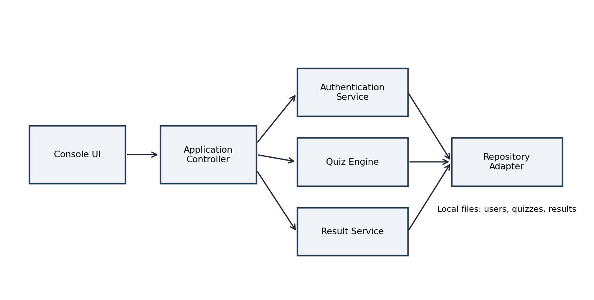
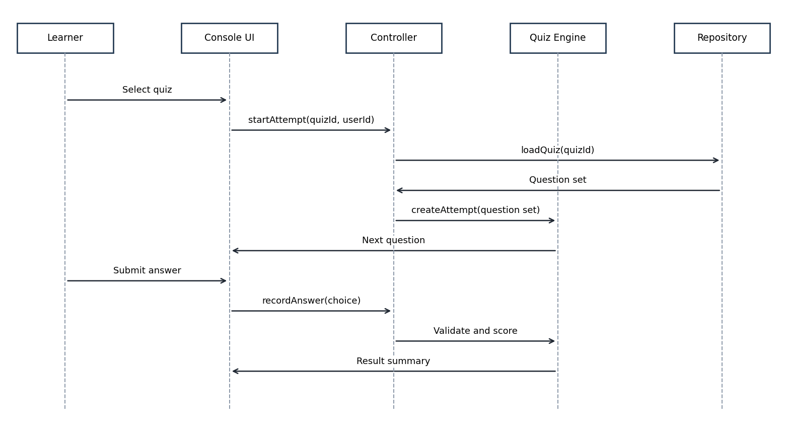
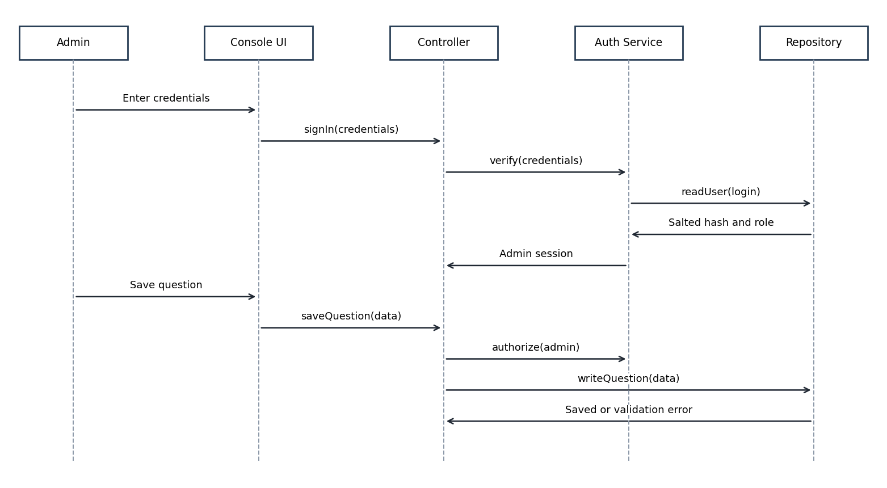

# Software Architecture and Design Specification

Team 14 | Deliverable 1 | Part C | Version 1.0 | 28 September 2026

Describes the original layered console architecture, data design, security boundaries, interfaces, and diagrams. Extracted from Deliverable 1, version 1.0, dated 28 September 2026. Requirement IDs, test IDs, expected results, and diagrams retain the source baseline. The later Iteration 3 website is documented separately in web/README.md.

Companion files: [SRS](SRS.md) (Part A), [test cases](Test_Cases.md) (Part B), and [SAD](SAD.md) (Part C).

## 1 Introduction and design drivers

The design implements the requirements in Part A with a small modular C++17 application. Primary drivers are clear console interaction, deterministic scoring, persistent local records, and role restricted administration. The application runs as one process on one machine.

## 2 Architecture pattern

Use a layered architecture: console presentation calls an application controller; domain services implement authentication, quiz attempts, and result access; a repository adapter handles persistence. The domain layer must not read from standard input or write directly to files. This separation permits deterministic unit tests and alternative storage later.

## 3 Component diagram and responsibilities

*Figure 2  UML style component diagram and dependency direction*

| Component | Responsibility | Requirement links |
| --- | --- | --- |
| Console UI | Render menus, collect and validate basic input | FR-05 to FR-07, NFR-03 |
| Controller | Maintain session, route commands, enforce admin gates | FR-02, FR-03, FR-04, FR-10, SEC-02 |
| Authentication Service | Verify password hash and role, issue in process session | FR-01, FR-02, SEC-01 |
| Quiz Engine | Load questions, record choices, calculate score | FR-04 to FR-08 |
| Result Service | Persist attempts and filter learner or admin views | FR-09, FR-10, SEC-03 |
| Repository Adapter | Validate records and commit data safely | FR-11, NFR-02, SEC-04 |

## 4 Data design

| Entity | Core fields and constraints |
| --- | --- |
| User | userId, unique username, passwordHash, salt, role in {Learner, Admin}; no plaintext credential field. |
| Question | questionId, prompt, choices[4], correctChoice in {A, B, C, D}, active flag. |
| Quiz | quizId, title, ordered questionIds with at least one active question. |
| Attempt | attemptId, userId, quizId, submittedAt, selectedChoices, correctCount, totalQuestions; score is derived. |

Stable identifiers preserve references if display titles change. A submitted attempt stores an immutable snapshot of its answer evaluation so subsequent question edits do not silently change historical scores. Repository writes create a validated replacement file and then rename it over the old file; failure leaves the old file available.

## 5 Security architecture

Trust boundary: console input and disk records are untrusted; domain operations receive an authenticated session object. The controller denies unauthorized commands and services independently recheck permissions. The authentication service uses a vetted Argon2id library with independent random salts and never logs credentials. Result queries derive the owner from the session, not a supplied username. The repository validates schema and enum values before constructing domain objects.

## 6 Detailed interaction design

### 6.1 Learner takes a quiz

*Figure 3  UML sequence diagram for quiz attempt and scoring*

The quiz engine retains the selected question order for the attempt, records one valid answer for each question, and computes the result exactly once on submission. Persistence must succeed before the console reports a saved result.

### 6.2 Administrator maintains a question

*Figure 4  UML sequence diagram for authenticated question update*

Both the controller and the administrative service verify authorization. Validation occurs before the repository commit; a failed commit returns an error and does not claim success.

## 7 Internal API design

Because this is a single process console application, these are C++ service interfaces rather than HTTP endpoints. Result&lt;T&gt; carries either a value or a typed error; IDs are opaque integers. Methods accept structured input rather than parsing console strings.

| Operation | Input | Output and error behavior |
| --- | --- | --- |
| AuthService::registerLearner | username, password | Result&lt;UserId&gt;; DuplicateUser, ValidationError, StorageError |
| AuthService::signIn | username, password | Result&lt;Session&gt;; AuthenticationFailed, StorageError |
| QuizService::saveQuestion | AdminSession, QuestionDraft | Result&lt;QuestionId&gt;; AccessDenied, ValidationError, StorageError |
| QuizService::saveQuiz | AdminSession, QuizDraft | Result&lt;QuizId&gt;; AccessDenied, UnknownQuestion, StorageError |
| QuizService::listQuizzes | LearnerSession | Result&lt;vector&lt;QuizSummary&gt;&gt;; StorageError |
| AttemptService::start | LearnerSession, QuizId | Result&lt;AttemptId&gt;; QuizUnavailable, StorageError |
| AttemptService::answer | LearnerSession, AttemptId, Choice | Result&lt;NextQuestion&gt;; InvalidChoice, AttemptClosed |
| AttemptService::submit | LearnerSession, AttemptId | Result&lt;Score&gt;; IncompleteAttempt, StorageError |
| ResultService::ownHistory | LearnerSession | Result&lt;vector&lt;Result&gt;&gt;; AccessDenied, StorageError |
| ResultService::summary | AdminSession | Result&lt;vector&lt;Result&gt;&gt;; AccessDenied, StorageError |

## 8 Error handling and recovery

| Condition | Handling |
| --- | --- |
| Invalid console input | Explain accepted values and re-prompt; do not mutate attempt state. |
| Authentication or role failure | Return generic sign in failure or access denied; do not reveal which credential was wrong. |
| Invalid record on disk | Reject record, report recovery action, and do not infer elevated privileges. |
| Write failure | Return StorageError; retain last committed file and allow retry after storage is repaired. |
| Missing quiz or question | Return typed error; do not dereference absent data or show a partial result. |

## 9 Architecture traceability

| Design element | Requirement coverage | Verification |
| --- | --- | --- |
| Console UI and Controller | FR-01 to FR-07, FR-10, NFR-03, SEC-02 | TC-01 to TC-06, TC-09 |
| Authentication Service | FR-01, FR-02, SEC-01 | TC-01, TC-02 |
| Quiz Engine | FR-04 to FR-08 | TC-04 to TC-07 |
| Result Service | FR-09, FR-10, SEC-03 | TC-08, TC-09 |
| Repository Adapter | FR-11, NFR-02, SEC-04 | TC-01, TC-04, TC-10 |
| Build and performance harness | NFR-01, NFR-04 | TC-11, TC-12 |

## 10 Build and deployment view

Build a C++17 executable and link a vetted Argon2id password hashing dependency. At startup, create or open a configured local data directory and load validated records. Distribute a build guide and seed administration procedure with the implementation; do not ship a hard coded default password. The first administrator is provisioned locally during setup through an explicit one time command.

## 11 Review checklist

Before submission, verify that the implementation language and storage choice still match this baseline, replace any changed interface signature, execute the planned tests, and record observed results. This document specifies the proposed system and tests; it does not state that implementation or validation has already completed.
