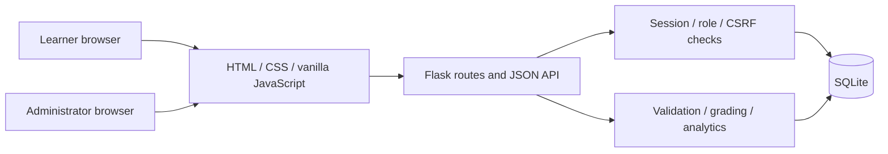
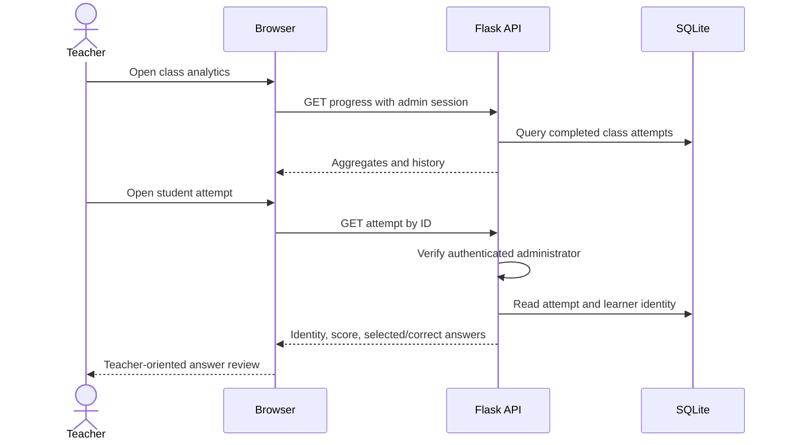

# Software Architecture and Design: web addendum

Version 1.1 | Prepared 17 November 2026 | Team 14

## 1 Introduction and scope

This document describes the implemented Iteration 3 website. The [original SAD](SAD.md) remains the console baseline and contains its component and two sequence diagrams. The browser application is a separate Flask/SQLite implementation, rather than an HTTP wrapper around the C++ executable. Requirements are [IT3-01 to IT3-05](SRS_Atomic_Revision.md#7-iteration-3-web-extension-requirements).

## 2 Architecture and components

The application uses a browser/API/database separation. The implementation is small and kept in a Flask application factory; it is not claimed to be a microservice system.



| Component | Source | Responsibility |
| --- | --- | --- |
| Browser shell and pages | `web/static/index.html`, `app.js`, `style.css` | Role-specific rendering, filtering, forms, quiz runner, reviews, analytics |
| Application factory and routes | `web/app.py:create_app` | Configure storage/security; handle API requests and serve the browser shell |
| Authorization helpers | `require_user`, CSRF hook | Authenticate each protected request; enforce administrator role and CSRF checks |
| Quiz submission | `start_quiz`, `submit` | Save run snapshot, withhold answer keys, grade answers, persist one completed attempt |
| Analytics and review | `progress`, `attempt` | Apply ownership; return personal/class aggregates and authorized answer reviews |
| Starter catalogue | `web/seed.py` | Seed 28 short subject/grade quizzes |

## 3 Data design

| SQLite table | Key data and constraints |
| --- | --- |
| users | ID, unique email, name, password hash, learner/admin role, grade, demo marker |
| quizzes | ID, title, subject, grade, description, embedded question JSON, active flag |
| runs | Random run ID, owner ID, full server-side quiz snapshot, start time |
| attempts | ID, unique run ID, owner ID, saved quiz metadata, score/total, duration, UTC date, review JSON |
| login_failures | Address/email key and timestamp for the login throttle |

Questions are embedded JSON within a web quiz. The console instead maintains separate question and quiz repositories. Attempt metadata and answer reviews are saved snapshots; edits and archives preserve historical results. The unique attempt run ID and transaction support submission idempotency. These are different stores; migration is not implemented.

## 4 Security architecture

Trust boundaries are browser-to-server requests and server-to-storage operations. A signed session identifies the account; the server reloads its role. State-changing API requests require a session-bound CSRF token. Cookies use HttpOnly and SameSite=Strict; Secure is enabled for HTTPS deployment. Passwords use Werkzeug scrypt. Parameterized SQL carries untrusted values. Learner result access checks ownership, while an administrator may inspect class results. Quiz-start responses omit the answer key. Runtime keys/databases are ignored by Git. These are application controls, not a claim of penetration-test certification.

## 5 Interaction design

### 5.1 Learner submits a quiz

```mermaid
sequenceDiagram
    actor Learner
    participant Browser
    participant API as Flask API
    participant DB as SQLite
    Learner->>Browser: Select quiz
    Browser->>API: POST quiz start + session/CSRF
    API->>DB: Save owned run and quiz snapshot
    API-->>Browser: Run ID and questions without keys
    Learner->>Browser: Answer and submit
    Browser->>API: POST run submit + answers
    API->>DB: BEGIN IMMEDIATE; load owned run
    alt Completed run exists
        API-->>Browser: Existing attempt ID
    else First valid submission
        API->>API: Validate and grade snapshot
        API->>DB: Save attempt and commit
        API-->>Browser: Attempt ID
    end
    Browser->>API: GET owned result
    API-->>Browser: Saved score and answer review
```

### 5.2 Administrator reviews a student



## 6 API design

| Method and route | Purpose | Access |
| --- | --- | --- |
| GET `/api/session` | Public account data and CSRF token | Session-aware |
| POST `/api/register`, `/api/login`, `/api/logout` | Account/session lifecycle | CSRF required |
| GET `/api/quizzes` | Active catalogue without answer keys | Authenticated |
| POST `/api/quizzes/{id}/start` | Create owned snapshot run | Learner + CSRF |
| POST `/api/runs/{id}/submit` | Validate, grade, save/reuse result | Run owner + CSRF |
| GET `/api/attempts/{id}` | Saved answer review | Owner or administrator |
| GET `/api/progress` | Personal or class aggregates | Role determines scope |
| GET `/api/admin/quizzes/{id}` | Load editor data including key | Administrator |
| POST `/api/admin/quizzes` | Create quiz | Administrator + CSRF |
| PUT/DELETE `/api/admin/quizzes/{id}` | Edit/archive quiz | Administrator + CSRF |

## 7 Error handling and traceability

Invalid input normally returns JSON with HTTP 400; unauthenticated requests return 401; forbidden role/CSRF requests return 403; unavailable or unowned results return 404; duplicate registration returns 409; oversized requests return 413; the login throttle returns 429. The browser presents validation errors. A failed validation does not save an attempt; closing the request connection rolls back an uncommitted transaction. Errors are not proof of a successful save.

| Design decision | Requirements | Verification |
| --- | --- | --- |
| Server session/role/CSRF checks | IT3-01, SEC-02 intent | Authentication and role tests |
| Snapshot and answer-key redaction | IT3-03 | Mixed grading and snapshot tests |
| Transaction and unique run ID | IT3-03 | Concurrent submission test |
| Ownership-filtered progress | IT3-04, SEC-03 intent | Ownership and progress tests |
| Validated administrator editor | IT3-05 | Editor validation/archive tests |
| Teacher review with identity | IT3-05 | Administrator review regression test; PR #38 |

## 8 Deployment and limitations

The demo runs on loopback using Flask's development server. Production internet deployment requires a WSGI server, durable storage/key configuration, and HTTPS. The catalogue is starter grade-band content, short-answer grading is normalized exact matching, and proctoring/password-reset/email-verification features are outside the current release. See [web/README.md](../web/README.md) for commands and [reports](../docs/reports/README.md) for measured test coverage and its scope.
