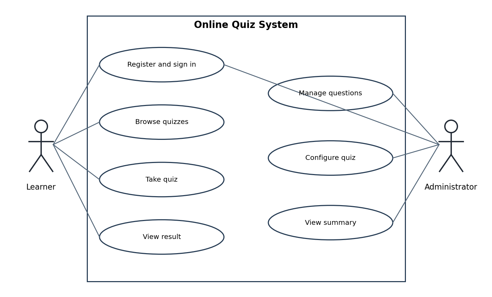

# Software Requirements Specification

Team 14 | Deliverable 1 | Part A | Version 1.0 | 28 September 2026

Defines the functional, non-functional, and security requirements for the original C++17 console system. Extracted from Deliverable 1, version 1.0, dated 28 September 2026. Requirement IDs, test IDs, expected results, and diagrams retain the source baseline. The later Iteration 3 website is documented separately in web/README.md.

Companion files: [SRS](SRS.md) (Part A), [test cases](Test_Cases.md) (Part B), and [SAD](SAD.md) (Part C).

## 1 Introduction

### 1.1 Purpose

Specify a local console application in which an administrator maintains multiple choice questions and quizzes, learners take quizzes, and the system calculates and stores results. The primary audience is the development team, reviewer, and test team.

### 1.2 Scope

The first release supports one user interacting with the console at a time. It stores named users, question banks, quiz definitions, attempts, and scores on the same machine. Internet play, payments, proctoring, multimedia questions, live multiplayer, and synchronization across devices are out of scope.

### 1.3 Terms

| Term | Meaning |
| --- | --- |
| Learner | Registered user who can take quizzes and inspect own results. |
| Administrator | Authorized user who can manage questions, configure quizzes, and view summary results. |
| Question | Prompt with four choices and exactly one correct answer. |
| Attempt | One submitted or in progress quiz run belonging to one learner. |

## 2 Overall description

The system has a menu driven console interface, a controller for input and role checks, services for authentication and quiz logic, and a repository adapter for local files. A quiz references an ordered set of active question IDs. The administrator prepares quiz content; the learner signs in, selects a quiz, answers each question, submits, and sees a score.

### 2.1 Users and operating environment

- Learners use a keyboard and terminal capable of displaying UTF 8 text.

- Administrators work at the same console but see management commands after authentication.

- Target environment: a C++17 compiler and a writable local data directory. No network service or browser is required.

### 2.2 Assumptions and constraints

- Each question has four text choices and exactly one correct choice, identified internally as A through D.

- An attempt is scored once on submission; each correct answer earns one point and there is no negative marking.

- The application must preserve data across a normal restart. Local storage is not a defense against an operating system administrator with direct file access.

## 3 External interface requirements

The console shall show a numbered menu with instructions for every prompt, report invalid entries without terminating, and display quiz scores as both correct count and percentage. Files used for persistence are internal implementation details and shall not be edited by learners through the application.

## 4 Functional requirements

### FR-01  Registration

The system shall create a learner account when a unique nonempty username and a password of at least 8 characters are provided; duplicate usernames shall be rejected.

### FR-02  Sign in

The system shall authenticate a registered username and password before displaying learner or administrator actions; an invalid pair shall show a generic failure message.

### FR-03  Question maintenance

An authenticated administrator shall create, edit, or deactivate a question only when its prompt and four choices are nonempty and exactly one correct choice is selected.

### FR-04  Quiz configuration

An authenticated administrator shall create or edit a quiz with a nonempty title and at least one active question; a quiz may not reference an unknown question.

### FR-05  Quiz discovery

An authenticated learner shall see available quizzes with a title and question count and may select one by its displayed identifier.

### FR-06  Attempt flow

For a selected quiz the system shall present each configured question exactly once, with choices A through D, and record one selected choice per question.

### FR-07  Input recovery

When an answer is not A, B, C, or D, the system shall show an error and re-prompt the same question without recording the invalid input.

### FR-08  Scoring

On submission the system shall calculate correctCount as the count of stored answers matching the answer key and percentage as 100 × correctCount / totalQuestions, rounded to one decimal place.

### FR-09  Own results

A learner shall see only their own completed attempts with quiz title, date, correct count, total count, and percentage.

### FR-10  Admin summary

An administrator shall see completed attempts with username, quiz title, date, and score; an ordinary learner shall not be able to invoke this operation.

### FR-11  Persistence

The system shall save account, quiz, question, and completed attempt records before confirming successful create, edit, or submission operations, and reload them after restart.

## 5 Nonfunctional requirements

### NFR-01  Responsiveness

With at most 1,000 stored questions and 10,000 attempts on the reference machine, a menu transition or question load shall complete within 2 seconds for 95% of local interactions, excluding time waiting for user input.

### NFR-02  Recovery

If a file write fails, the operation shall report failure and leave the last committed data file readable; updates shall use a temporary file and atomic replacement where the operating system supports it.

### NFR-03  Usability

Every menu and question prompt shall show accepted input values; an invalid choice shall produce a specific correction prompt without an application crash.

### NFR-04  Portability

The source shall compile as C++17 on a supported Windows or Linux build with a documented build command; platform specific file handling shall be isolated in the repository adapter.

## 6 Security objectives and requirements

Objectives: SO-01 restrict question and quiz changes and aggregate result access to administrators; SO-02 protect stored credentials and avoid exposing a learner’s results to another learner; SO-03 preserve valid saved state when input or storage operations fail.

### SEC-01  Password protection

The system shall use a vetted password hashing library with a unique random salt per account and an adaptive hash algorithm such as Argon2id; it shall never persist plaintext passwords.

### SEC-02  Role checks

The controller shall check the authenticated role on every administrator operation, including direct internal calls, and shall deny a learner account.

### SEC-03  Result ownership

The result service shall compare the authenticated learner ID with the owner ID on every own history request; it shall not accept an arbitrary owner ID from console input.

### SEC-04  File validation

On loading local data, the repository shall reject malformed records and report a recoverable error rather than interpreting them as privileged accounts or valid scores.

## 7 Use case model

*Figure 1  UML use case diagram for learner and administrator*

Main success path for Take quiz: sign in, browse a quiz, select it, answer each question, submit, and view the result. Alternate path: invalid answer repeats the current prompt. Precondition: an administrator has configured at least one available quiz.

## 8 Requirements acceptance summary

The requirements are accepted only after the test cases in Part B pass on the documented reference environment. Any implementation change that affects the behavior, score formula, storage, or security checks requires an updated requirement and test mapping.
