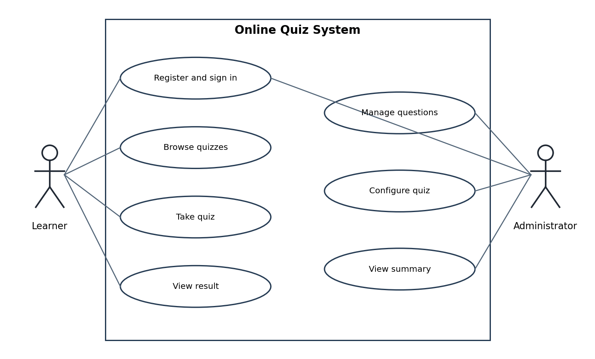

# Software Requirements Specification: atomic revision

Version 1.1 | Prepared 17 November 2026 | Team 14

## 1 Introduction

### 1.1 Purpose

Specify independently verifiable behaviors and preserve traceability to the original 19 requirements and their GitHub issues. This is an evaluation revision prepared after implementation, not a replacement dated as if it existed before development. The [version 1.0 SRS](SRS_v1_Baseline.md) and original Word source remain unchanged. The [current SRS](SRS.md) and the atomic rows below use role-based user stories, with the original technical statements retained as acceptance criteria.

### 1.2 Scope

The baseline is the local C++17 console application. The Iteration 3 extension is a separate browser application for subject/grade discovery, mixed question formats, progress analytics, and teacher review. The two applications have separate storage and credentials. There is no automatic data migration.

### 1.3 Definitions

A learner takes quizzes and reviews owned results. An administrator manages content and reviews class results. An atomic requirement specifies one behavior or measurable constraint that can be verified separately. Conditions and record fields may describe one behavior; independent actions receive separate IDs. A parent ID remains the GitHub planning item; its child IDs refine acceptance criteria without creating historical work items.

### 1.4 References

[Original SRS](SRS_v1_Baseline.md), [current user-story SRS](SRS.md), [baseline test plan](Test_Plan_v1_Before.md), [test cases with actual results](Test_Cases.md), [updated test plan](Test_Plan_v2_After.md), [original SAD](SAD.md), [web SAD addendum](SAD_Web_Addendum.md), and [backlog traceability](../docs/evaluation/backlog-traceability.md). The supplied evaluator checklist asks for clear, measurable FRs/NFRs; the atomic decomposition also addresses the viva feedback reported by the team.

### 1.5 Document overview

Sections 2-3 define the environment and interfaces; sections 4-6 refine the original requirements; section 7 specifies the web extension; sections 8-9 provide use cases and traceability.

## 2 Overall description

The console uses presentation, controller, domain-service, and repository layers. The web extension uses a browser interface, a Flask HTTP API, and SQLite. Learners and administrators have distinct workspaces. Supported console builds are Windows and Linux with C++17 and libsodium. The web app requires Python 3.12 or later and a modern browser. A writable local data directory is required. Production internet hosting and cross-device synchronization are outside the demonstrated local deployment.

## 3 External interfaces

Console interaction uses numbered menus and A-D answers. Web interaction uses forms, catalogue filters, a quiz runner, result review, and analytics. Browser/API messages use JSON over same-origin HTTP in the local demo; internet deployment requires HTTPS. A keyboard and display are sufficient. Console data uses versioned local files; web data uses SQLite. Libraries and build/run commands are identified in the root and web READMEs.

## 4 Atomic functional requirements: console baseline

Each row is a refinement of an existing parent, not a claim of a new completed issue. Its role-based story states the user need, while the acceptance criterion retains the independently verifiable behavior.

| Atomic ID | User story | Acceptance criterion |
| --- | --- | --- |
| FR-01.1 | As a learner, I want the system to create a learner account from valid registration details so that I can register with valid account details. | The system shall create a learner account from valid registration details. |
| FR-01.2 | As a learner, I want registration to reject an empty username so that I can register with valid account details. | Registration shall reject an empty username. |
| FR-01.3 | As a learner, I want registration to reject a password shorter than eight characters so that I can register with valid account details. | Registration shall reject a password shorter than eight characters. |
| FR-01.4 | As a learner, I want registration to reject an existing username so that I can register with valid account details. | Registration shall reject an existing username. |
| FR-02.1 | As a user, I want my valid stored credentials to establish an authenticated session so that I can access the workspace authorized for my account. | Valid stored credentials shall establish an authenticated session. |
| FR-02.2 | As a user, I want my session role to be obtained from the stored account so that I can access the workspace authorized for my account. | The session role shall be obtained from the stored account. |
| FR-02.3 | As a user, I want invalid usernames and invalid passwords to produce the same generic failure so that I can access the workspace authorized for my account. | Invalid usernames and invalid passwords shall produce the same generic failure. |
| FR-03.1 | As an administrator, I want to create a valid question so that I can maintain valid question content. | An authorized administrator shall be able to create a valid question. |
| FR-03.2 | As an administrator, I want to modify a question so that I can maintain valid question content. | An authorized administrator shall be able to modify a question. |
| FR-03.3 | As an administrator, I want to deactivate a question so that I can maintain valid question content. | An authorized administrator shall be able to deactivate a question. |
| FR-03.4 | As an administrator, I want question validation to reject an empty prompt so that I can maintain valid question content. | Question validation shall reject an empty prompt. |
| FR-03.5 | As an administrator, I want question validation to reject an empty answer option so that I can maintain valid question content. | Question validation shall reject an empty answer option. |
| FR-03.6 | As an administrator, I want question validation to reject an answer key outside the four choices so that I can maintain valid question content. | Question validation shall reject an answer key outside the four choices. |
| FR-04.1 | As an administrator, I want to create a valid quiz so that I can configure valid assessments. | An authorized administrator shall be able to create a valid quiz. |
| FR-04.2 | As an administrator, I want to modify a quiz so that I can configure valid assessments. | An authorized administrator shall be able to modify a quiz. |
| FR-04.3 | As an administrator, I want quiz validation to reject an empty title so that I can configure valid assessments. | Quiz validation shall reject an empty title. |
| FR-04.4 | As an administrator, I want quiz validation to reject a quiz with no active question so that I can configure valid assessments. | Quiz validation shall reject a quiz with no active question. |
| FR-04.5 | As an administrator, I want quiz validation to reject an unknown question reference so that I can configure valid assessments. | Quiz validation shall reject an unknown question reference. |
| FR-05.1 | As a learner, I want quiz discovery to display each available quiz's identifier, title, and question count so that I can choose a quiz to practise. | Quiz discovery shall display each available quiz's identifier, title, and question count. |
| FR-05.2 | As a learner, I want to select an available quiz by identifier so that I can choose a quiz to practise. | A learner shall be able to select an available quiz by identifier. |
| FR-06.1 | As a learner, I want an attempt to present configured questions in their saved order so that I can complete the configured quiz. | An attempt shall present configured questions in their saved order. |
| FR-06.2 | As a learner, I want the question prompt to display the four configured choices so that I can complete the configured quiz. | The question prompt shall display the four configured choices. |
| FR-06.3 | As a learner, I want the attempt to record one valid selected choice for each answered question so that I can complete the configured quiz. | The attempt shall record one valid selected choice for each answered question. |
| FR-07.1 | As a learner, I want an answer outside uppercase A-D to be rejected so that I can correct my answer without losing my place. | An answer outside uppercase A-D shall be rejected. |
| FR-07.2 | As a learner, I want an invalid answer to leave the current question unchanged so that I can correct my answer without losing my place. | An invalid answer shall leave the current question unchanged. |
| FR-07.3 | As a learner, I want an invalid answer not to be stored as a selected choice so that I can correct my answer without losing my place. | An invalid answer shall not be stored as a selected choice. |
| FR-07.4 | As a learner, I want invalid input to cause the same question to be prompted again so that I can correct my answer without losing my place. | Invalid input shall cause the same question to be prompted again. |
| FR-08.1 | As a learner, I want submission to calculate the number of selected answers matching the answer key so that I can understand my score accurately. | Submission shall calculate the number of selected answers matching the answer key. |
| FR-08.2 | As a learner, I want percentage to be calculated as 100 times correct count divided by question count so that I can understand my score accurately. | Percentage shall be calculated as 100 times correct count divided by question count. |
| FR-08.3 | As a learner, I want the console to display the percentage to one decimal place so that I can understand my score accurately. | The console shall display the percentage to one decimal place. |
| FR-09.1 | As a learner, I want learner history to return the authenticated learner's completed attempts so that I can track my completed attempts. | Learner history shall return the authenticated learner's completed attempts. |
| FR-09.2 | As a learner, I want each history record to display quiz title, date, correct/total counts, and percentage so that I can track my completed attempts. | Each history record shall display quiz title, date, correct/total counts, and percentage. |
| FR-10.1 | As an administrator, I want the administrator summary to include completed attempts across learners so that I can monitor learner performance with appropriate access. | The administrator summary shall include completed attempts across learners. |
| FR-10.2 | As an administrator, I want a summary record to display username, quiz title, date, and score so that I can monitor learner performance with appropriate access. | A summary record shall display username, quiz title, date, and score. |
| FR-10.3 | As an administrator, I want the administrator summary to deny a learner session so that I can monitor learner performance with appropriate access. | The administrator summary shall deny a learner session. |
| FR-11.1 | As a user, I want account creation to report success only after the account is saved so that I can rely on committed data. | Account creation shall report success only after the account is saved. |
| FR-11.2 | As a user, I want question changes to report success only after the changes are saved so that I can rely on committed data. | Question changes shall report success only after the changes are saved. |
| FR-11.3 | As a user, I want quiz changes to report success only after the changes are saved so that I can rely on committed data. | Quiz changes shall report success only after the changes are saved. |
| FR-11.4 | As a user, I want submission to report success only after the completed attempt is saved so that I can rely on committed data. | Submission shall report success only after the completed attempt is saved. |
| FR-11.5 | As a user, I want saved accounts to be recoverable after a normal restart so that I can rely on committed data. | Saved accounts shall be recoverable after a normal restart. |
| FR-11.6 | As a user, I want saved questions to be recoverable after a normal restart so that I can rely on committed data. | Saved questions shall be recoverable after a normal restart. |
| FR-11.7 | As a user, I want saved quizzes to be recoverable after a normal restart so that I can rely on committed data. | Saved quizzes shall be recoverable after a normal restart. |
| FR-11.8 | As a user, I want saved completed attempts to be recoverable after a normal restart so that I can rely on committed data. | Saved completed attempts shall be recoverable after a normal restart. |

## 5 Atomic non-functional requirements: console baseline

| Atomic ID | User story | Acceptance criterion and verification boundary |
| --- | --- | --- |
| NFR-01.1 | As a user, I want at least 95% of measured menu transitions on the documented reference machine to finish within two seconds with 1,000 questions and 10,000 attempts, excluding human input time so that I can use the application promptly at the required data volume. | On the documented reference machine, at least 95% of the measured menu transitions shall finish within two seconds with 1,000 questions and 10,000 attempts, excluding human input time. |
| NFR-01.2 | As a user, I want at least 95% of measured question loads on that reference machine and dataset to finish within two seconds, excluding human input time so that I can use the application promptly at the required data volume. | On that reference machine and dataset, at least 95% of measured question loads shall finish within two seconds, excluding human input time. |
| NFR-02.1 | As a user, I want a failed write to report failure so that I can recover without losing committed data. | A failed write shall report failure. |
| NFR-02.2 | As a user, I want a failed write to leave the last committed data readable so that I can recover without losing committed data. | A failed write shall leave the last committed data readable. |
| NFR-02.3 | As a user, I want file updates to be staged in a temporary file so that I can recover without losing committed data. | File updates shall be staged in a temporary file. |
| NFR-02.4 | As a user, I want a staged file to replace the committed file atomically where supported by the operating system so that I can recover without losing committed data. | A staged file shall replace the committed file atomically where supported by the operating system. |
| NFR-03.1 | As a user, I want a menu or question prompt to identify accepted input values so that I can correct mistakes while continuing to use the application. | A menu or question prompt shall identify accepted input values. |
| NFR-03.2 | As a user, I want invalid input to produce a specific correction message so that I can correct mistakes while continuing to use the application. | Invalid input shall produce a specific correction message. |
| NFR-03.3 | As a user, I want invalid input not to crash the application so that I can correct mistakes while continuing to use the application. | Invalid input shall not crash the application. |
| NFR-04.1 | As a user, I want the console source to compile as C++17 on the documented Windows toolchain so that I can use the application on a documented supported platform. | The console source shall compile as C++17 on the documented Windows toolchain. |
| NFR-04.2 | As a user, I want the console source to compile as C++17 on the documented Linux toolchain so that I can use the application on a documented supported platform. | The console source shall compile as C++17 on the documented Linux toolchain. |
| NFR-04.3 | As a user, I want build commands to be documented for each supported platform so that I can use the application on a documented supported platform. | Build commands shall be documented for each supported platform. |
| NFR-04.4 | As a user, I want platform-specific persistence operations to be isolated in the repository adapter so that I can use the application on a documented supported platform. | Platform-specific persistence operations shall be isolated in the repository adapter. |

The NFR-01 measurement is a console benchmark; it is not a website latency or concurrent-user capacity claim.

## 6 Security objectives and atomic requirements

Objectives: SO-01 restrict administration to administrators; SO-02 protect credentials and learner-result privacy; SO-03 preserve valid committed state during invalid input or storage failure.

| Atomic ID | User story | Acceptance criterion |
| --- | --- | --- |
| SEC-01.1 | As a user, I want stored password verification to use a vetted adaptive password-hashing library so that my stored credentials remain protected. | Stored password verification shall use a vetted adaptive password-hashing library. |
| SEC-01.2 | As a user, I want each account's hash to use an independently generated random salt so that my stored credentials remain protected. | Each account's hash shall use an independently generated random salt. |
| SEC-01.3 | As a user, I want password verification to use the library's verification API so that my stored credentials remain protected. | Password verification shall use the library's verification API. |
| SEC-01.4 | As a user, I want persisted account records not to contain plaintext passwords so that my stored credentials remain protected. | Persisted account records shall not contain plaintext passwords. |
| SEC-02.1 | As an administrator, I want the controller to check the stored role before dispatching an administrator operation so that privileged actions remain restricted to administrators. | The controller shall check the stored role before dispatching an administrator operation. |
| SEC-02.2 | As an administrator, I want direct calls to administrator services to deny learner sessions so that privileged actions remain restricted to administrators. | Direct calls to administrator services shall deny learner sessions. |
| SEC-03.1 | As a learner, I want history ownership to be derived from the authenticated session so that learner results remain private. | History ownership shall be derived from the authenticated session. |
| SEC-03.2 | As a learner, I want a learner history query to exclude other learners' attempts so that learner results remain private. | A learner history query shall exclude other learners' attempts. |
| SEC-03.3 | As a learner, I want an arbitrary supplied owner identifier not to authorize access to history so that learner results remain private. | An arbitrary supplied owner identifier shall not authorize access to history. |
| SEC-04.1 | As a user, I want repository loading to reject malformed records so that invalid stored data is not trusted. | Repository loading shall reject malformed records. |
| SEC-04.2 | As a user, I want a malformed record to produce a recoverable error so that invalid stored data is not trusted. | A malformed record shall produce a recoverable error. |
| SEC-04.3 | As a user, I want a malformed account record not to create an administrator session so that invalid stored data is not trusted. | A malformed account record shall not create an administrator session. |

The console implements SEC-01 using libsodium Argon2id. The web extension independently uses Werkzeug scrypt; both use vetted adaptive hashing, but they do not share account files.

## 7 Iteration 3 web-extension requirements

These refine the acceptance criteria of issues #32-#36. The browser extension is a documented scope change from version 1.0.

| Atomic ID | User story | Acceptance criterion | Parent issue |
| --- | --- | --- | --- |
| IT3-01.1 | As a learner, I want web registration to create a learner account so that my account uses the correct access controls. | Web registration shall create a learner account. | #32 |
| IT3-01.2 | As a user, I want web login to authenticate a stored account so that my account uses the correct access controls. | Web login shall authenticate a stored account. | #32 |
| IT3-01.3 | As a user, I want logout to clear the authenticated session so that my account uses the correct access controls. | Logout shall clear the authenticated session. | #32 |
| IT3-01.4 | As a user, I want navigation to display the signed-in role's workspace so that my account uses the correct access controls. | Navigation shall display the signed-in role's workspace. | #32 |
| IT3-01.5 | As an administrator, I want an administrator endpoint to reject a learner request so that my account uses the correct access controls. | An administrator endpoint shall reject a learner request. | #32 |
| IT3-01.6 | As a user, I want a state-changing API request with an invalid CSRF token to be rejected so that my account uses the correct access controls. | A state-changing API request with an invalid CSRF token shall be rejected. | #32 |
| IT3-02.1 | As a learner, I want the learner home to display recent account activity so that I can find suitable practice quizzes. | The learner home shall display recent account activity. | #33 |
| IT3-02.2 | As a learner, I want the catalogue to filter quizzes by selected subject so that I can find suitable practice quizzes. | The catalogue shall filter quizzes by selected subject. | #33 |
| IT3-02.3 | As a learner, I want the catalogue to filter quizzes by selected grade from 6 through 12 so that I can find suitable practice quizzes. | The catalogue shall filter quizzes by selected grade from 6 through 12. | #33 |
| IT3-02.4 | As a learner, I want the catalogue to filter quizzes by entered search text so that I can find suitable practice quizzes. | The catalogue shall filter quizzes by entered search text. | #33 |
| IT3-02.5 | As a learner, I want the catalogue to show an empty state when no quiz matches the combined filters so that I can find suitable practice quizzes. | The catalogue shall show an empty state when no quiz matches the combined filters. | #33 |
| IT3-03.1 | As a learner, I want the quiz runner to accept answers to multiple-choice questions so that I can complete and review a reliable quiz attempt. | The quiz runner shall accept answers to multiple-choice questions. | #34 |
| IT3-03.2 | As a learner, I want the quiz runner to accept answers to true/false questions so that I can complete and review a reliable quiz attempt. | The quiz runner shall accept answers to true/false questions. | #34 |
| IT3-03.3 | As a learner, I want the quiz runner to accept answers to short-answer questions so that I can complete and review a reliable quiz attempt. | The quiz runner shall accept answers to short-answer questions. | #34 |
| IT3-03.4 | As a learner, I want incomplete submissions to be rejected so that I can complete and review a reliable quiz attempt. | Incomplete submissions shall be rejected. | #34 |
| IT3-03.5 | As a learner, I want the server to grade answers against the saved run snapshot so that I can complete and review a reliable quiz attempt. | The server shall grade answers against the saved run snapshot. | #34 |
| IT3-03.6 | As a learner, I want repeated submissions of the same run to return the existing saved attempt so that I can complete and review a reliable quiz attempt. | Repeated submissions of the same run shall return the existing saved attempt. | #34 |
| IT3-03.7 | As a learner, I want a learner quiz-start response to omit answer keys so that I can complete and review a reliable quiz attempt. | A learner quiz-start response shall omit answer keys. | #34 |
| IT3-03.8 | As a learner, I want a submitted result to provide the answer review and explanations so that I can complete and review a reliable quiz attempt. | A submitted result shall provide the answer review and explanations. | #34 |
| IT3-04.1 | As a learner, I want learner progress to aggregate only the signed-in learner's attempts so that I can understand my own learning progress. | Learner progress shall aggregate only the signed-in learner's attempts. | #35 |
| IT3-04.2 | As a learner, I want progress to report subject accuracy from saved attempts so that I can understand my own learning progress. | Progress shall report subject accuracy from saved attempts. | #35 |
| IT3-04.3 | As a learner, I want progress to report daily activity using UTC dates so that I can understand my own learning progress. | Progress shall report daily activity using UTC dates. | #35 |
| IT3-04.4 | As a learner, I want a new learner to see empty history so that I can understand my own learning progress. | A new learner shall see empty history. | #35 |
| IT3-05.1 | As an administrator, I want to create a validated quiz so that I can manage assessments and review learner performance. | An administrator shall be able to create a validated quiz. | #36 |
| IT3-05.2 | As an administrator, I want to edit an active quiz so that I can manage assessments and review learner performance. | An administrator shall be able to edit an active quiz. | #36 |
| IT3-05.3 | As an administrator, I want to archive an active quiz so that I can manage assessments and review learner performance. | An administrator shall be able to archive an active quiz. | #36 |
| IT3-05.4 | As an administrator, I want class analytics to aggregate saved attempts across learners so that I can manage assessments and review learner performance. | Class analytics shall aggregate saved attempts across learners. | #36 |
| IT3-05.5 | As an administrator, I want administrator answer review to identify the learner so that I can manage assessments and review learner performance. | Administrator answer review shall identify the learner. | #36 / PR #38 |
| IT3-05.6 | As an administrator, I want administrator answer review to show each submitted and correct answer so that I can manage assessments and review learner performance. | Administrator answer review shall show each submitted and correct answer. | #36 / PR #38 |

## 8 Use cases

The original UML use-case diagram is retained below. The web extension adds subject/grade filtering, personal analytics, and detailed teacher review to the corresponding discovery/result flows.

UC-01: learner registers, signs in, selects a quiz, answers, submits, and reviews an owned result. Alternative flows: invalid credentials, invalid answer, unavailable quiz, incomplete submission, or failed save.

UC-02: administrator signs in, creates or edits valid quiz content, reviews class activity, and opens a learner's submitted result. Alternative flows: invalid content or denied permissions.

## 9 Traceability and review

The parent-to-issue and issue-to-test mapping is in [backlog traceability](../docs/evaluation/backlog-traceability.md). Child IDs inherit the parent's implementation evidence; an existing broad test does not imply a separate assertion for every child. Tests and remaining coverage gaps are identified in [the post-testing plan](Test_Plan_v2_After.md) and [reports](../docs/reports/README.md). Faculty acceptance of this revised scope/format is a review decision, not an assertion made by the implementation team.
